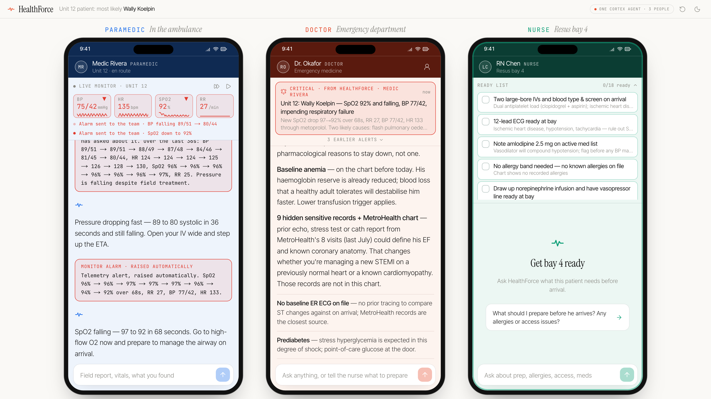
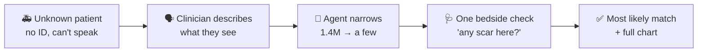
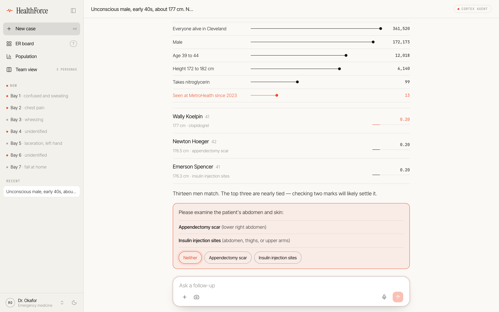
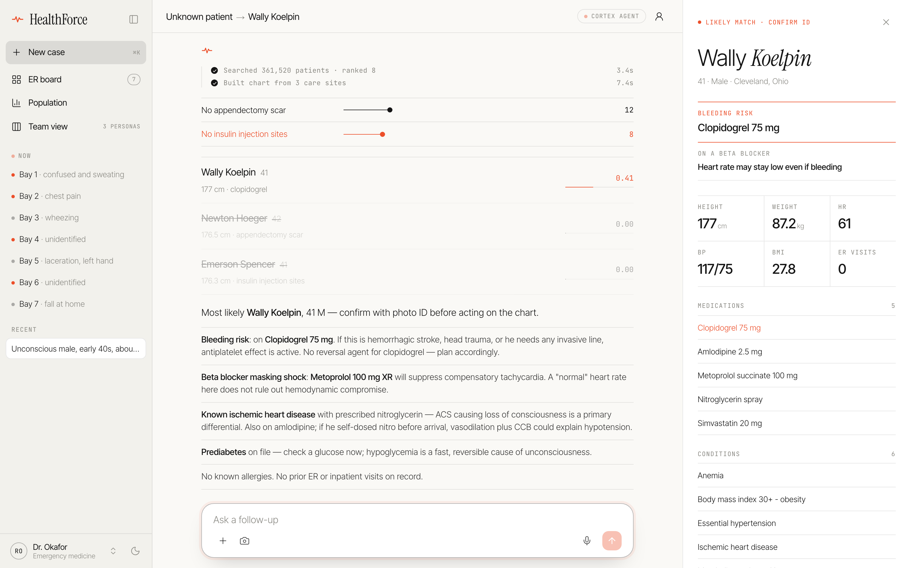
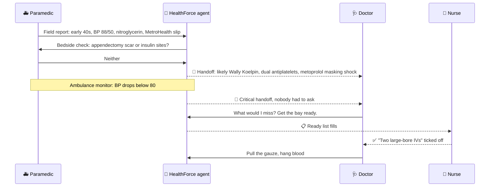
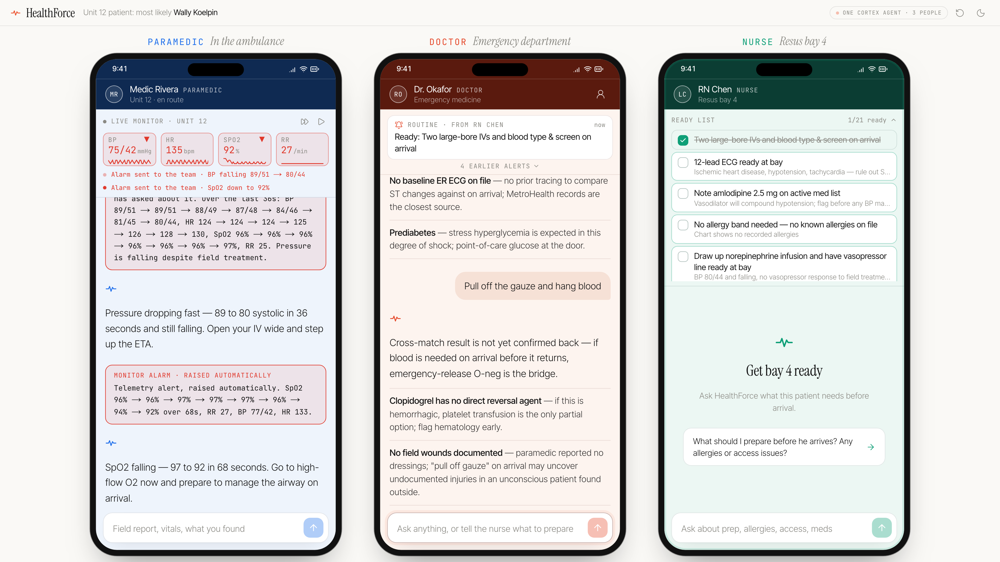
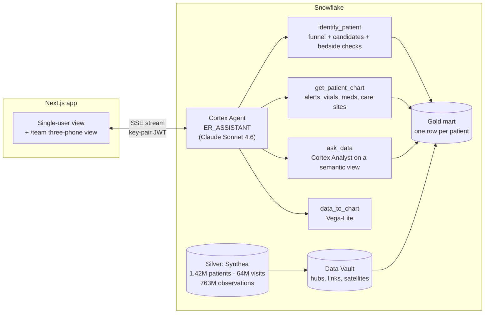

# HealthForce

> 🏆 **Winner, [Intelligence at Work Hackathon](https://cerebralvalley.ai/e/intelligence-at-work-hackathon)**, hosted by Cerebral Valley with Snowflake and Anthropic (Menlo Park, October 23, 2026)

**An unconscious patient arrives with no ID. HealthForce tells the ER team who they most likely are, and what in their records matters right now.**

A clinician describes what they can see: sex, rough age, height, a pill bottle, a hospital slip. A Claude-powered
Cortex Agent narrows 1.4 million patients to a handful, asks for one bedside check, names the most likely match,
and opens a chart pulled together from every care site that holds their records.





## The problem

A patient's history is scattered across hospitals, clinics and insurers. When they reach the ER unable to speak,
that history is effectively lost: the team doesn't know about the blood thinner, the allergy or the heart
condition until it's too late to matter. HealthForce unifies those records in Snowflake and puts an agent in front
of them that clinicians can talk to like a colleague.

## 1.4 million people to one, in two questions

Every clue becomes a filter. The agent turns vague phrases into ranges ("early 40s" is 39 to 44, "about 177 cm"
is 172 to 182), runs them in one scan, and draws the funnel so the team can see why it is confident.

*Unconscious male, early 40s, about 177 cm. Nitroglycerin spray and a MetroHealth slip in his jacket. Found in Cleveland.*



Three candidates are tied, so the agent asks for the one check that separates them. The clinician taps **Neither**,
two candidates drop out, and the chart opens: clopidogrel (bleeding risk), a beta blocker that can hide shock,
ischemic heart disease, and the records from three care sites.



## One agent, three phones (`/team`)

A real ER case involves a paramedic, a doctor and a nurse, each needing different things at different times. The
team view puts all three side by side, served by the same agent on the same case. Replies come back in each
person's register, and the agent hands work between phones.



Three things make it feel like a teammate rather than a chatbot:

- **It watches without being asked.** A simulated ambulance monitor streams vitals. When BP falls below 80 or SpO2
  below 92, the monitor alerts the agent itself, and the doctor and nurse get what they need.
- **It fills in the details.** "Hang blood" becomes the right blood product for this patient's group, with where
  the group came from, plus a fresh type and screen.
- **It flags what a busy team would miss.** Clinical replies end with up to three bold bullets: drug interactions,
  records held at another care site, tests that don't need repeating.



Sensitive records stay hidden until a clinician **breaks the glass**, and every access is logged.

## How it's built



The app draws tool results itself: the funnel and candidate list, the patient panel, and Analyst tables or charts.
The agent ends questions with an `options` block that the UI turns into quick-reply chips, and ends team replies
with `handoff` and `tasks` blocks that the app routes to the right phone.

| Layer | Where | What |
|---|---|---|
| Silver | `SYNTHETIC_HEALTHCARE_DATA_CLINICAL_AND_CLAIMS.SILVER` | Synthea: 1.42M patients, 64M visits, 763M observations, 12 metro areas, to Nov 2024 |
| Vault | `CLINICAL_CLAIMS_DV` | The team's Data Vault (AutomateDV): hubs, links, satellites, business vault |
| Gold | `HEALTHLINE.GOLD` | One row per patient (`PATIENT_PROFILE`), identifying marks, ER board, agent tools, semantic view, agent |

All patient data is synthetic.

## Try the demo

**Single-user view** (`/`):

1. **Bay 4** (or the first suggestion): *Unconscious male, early 40s, about 177 cm. Nitroglycerin spray and a
   MetroHealth slip in his jacket. Found in Cleveland.*
2. Tap **Neither** on the bedside check. Wally Koelpin leads and his chart opens.
3. Ask *Any ER visits before?*, then **Break the glass** on the hidden records.
4. Try **Bay 2**, *Who's waiting with a severe allergy?* and **Population** for briefings, Analyst answers and charts.

Keys: `d` toggles dark mode, `⌘K` starts a new case.

**Team view** (`/team`):

1. **Paramedic**: tap the field report, then **Neither** for the bedside check. The doctor's phone lights up.
2. **Doctor**: *What would I miss on this patient? Then get the bay ready for him.* The nurse's ready list fills.
3. **Nurse**: tick an item (the doctor sees it), then ask about allergies and access.
4. **Doctor**: *Pull off the gauze and hang blood*, then open the chart and break the glass.

The fast-forward button on the ambulance monitor runs the vitals feed at 3x.

<details>
<summary><b>Setup</b></summary>

Run as `ACCOUNTADMIN` on the `HACKATHON_JMZWKV` connection.

```bash
snow sql -c HACKATHON_JMZWKV -f snowflake/01_setup.sql     # warehouse, database, app role, service user
./scripts/setup-keypair.sh                                 # key pair for the service user (key stays in ~/.snowflake/keys)
snow sql -c HACKATHON_JMZWKV -f snowflake/02_gold.sql      # gold mart (size HEALTHLINE_WH up first; ~30s on XL)
snow sql -c HACKATHON_JMZWKV -f snowflake/03_tools.sql     # agent tools
cortex agent-studio sv-deploy --connection HACKATHON_JMZWKV \
  --file-path cortex_project/HEALTHLINE_ER.sv.yaml --fqn HEALTHLINE.GOLD.HEALTHLINE_ER
cortex agent-studio agent-deploy --connection HACKATHON_JMZWKV \
  --file-path cortex_project/ER_ASSISTANT.agent.yaml --fqn HEALTHLINE.GOLD.ER_ASSISTANT
snow sql -c HACKATHON_JMZWKV -f snowflake/04_access.sql    # grants, warehouse back to Small
snow sql -c HACKATHON_JMZWKV -f snowflake/05_blood_type.sql # synthetic blood groups (runs as ATTENDEE_ROLE)
```

Then the app:

```bash
cd web
cp .env.example .env.local   # set SNOWFLAKE_PRIVATE_KEY_PATH
pnpm install
pnpm dev                     # http://localhost:3000
```

**Screenshots and video.** With the app running, `cd web && node scripts/readme-shots.mjs` retakes the README
screenshots into `docs/readme/`, and `node scripts/record-demo.mjs` records the team flow with captions to
`web/demo-video/healthforce-team-demo.webm` (`npx playwright install chromium` once first). Both drive the real
agent, so the wording varies run to run. Convert the video for sharing with
`ffmpeg -i healthforce-team-demo.webm -c:v libx264 -pix_fmt yuv420p healthforce-team-demo.mp4`.

</details>

<details>
<summary><b>Implementation notes</b></summary>

**Naming.** HealthForce was called Healthline. The Snowflake objects keep the `HEALTHLINE` names (database,
warehouse, app role and service user) so existing deployments keep working.

**Joins back to the vault.** `PATIENT_PROFILE.PATIENT_HK` uses the vault's hash key formula, so gold rows join
straight back to the vault. Care site names come from the vault's organization satellite.

**Vault sampling.** The vault's `STAGING.BASE_*` views each take `LIMIT 100000` rows independently, so most sampled
patients have no linked meds or visits (7% of medication links hit a sampled patient). Until the vault loads whole
patient histories, gold reads patient-level facts from Silver. Sampling by patient instead fixes it, for example in
every `BASE_*` view:

```sql
WHERE patient_id IN (SELECT patient_id FROM SILVER.PATIENTS WHERE synthea_city = 'CLEVELAND')
```

Ages and "active" are computed as of 2024-11-01, where the data ends.

**Team protocol.** The protocol lives in `web/lib/personas.ts` and goes out with the first message of a case, so
the deployed agent needs no changes. A matching "Team mode" section is in `ER_ASSISTANT.agent.yaml` for the next
redeploy. One agent run at a time per case; messages from other phones queue.

**Blood groups.** Synthea has no blood types, so `HEALTHFORCE.CLINICAL.PATIENT_BLOOD_TYPE` holds a synthetic one per
patient (US frequencies, fixed per patient, stamped on their latest clinical visit). The app reads it through
`/api/blood-type` once the patient is identified and passes it to the agent with the open ready list.

**Break glass.** Every access is written to `HEALTHLINE.GOLD.ACCESS_LOG`.

</details>

## Layout

```
snowflake/       SQL for setup, gold mart, tools, grants and blood groups, in run order
cortex_project/  Semantic view and agent specs (deployed with cortex agent-studio)
scripts/         Service user key pair
docs/readme/     Screenshots (retake with web/scripts/readme-shots.mjs)
web/             Next.js 16 app: app/api (agent stream, ER board, break glass, blood type), components, lib
```
